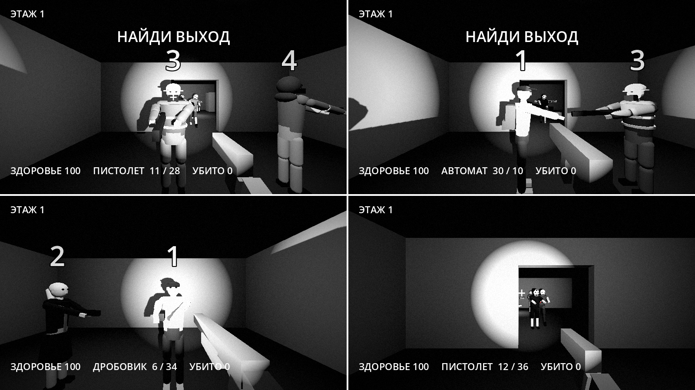
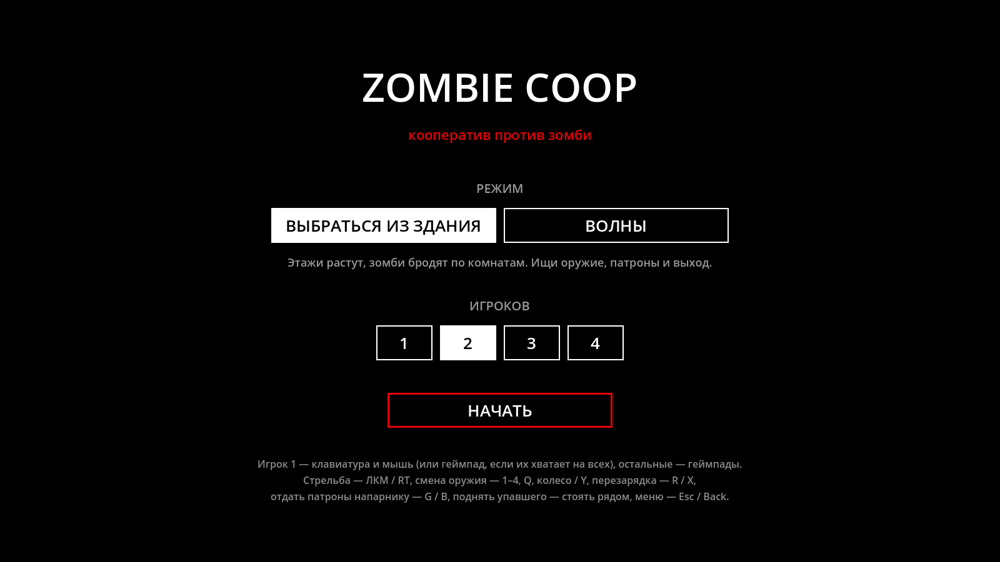
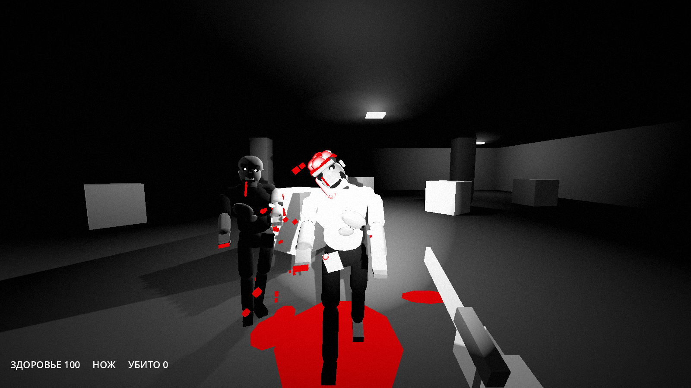
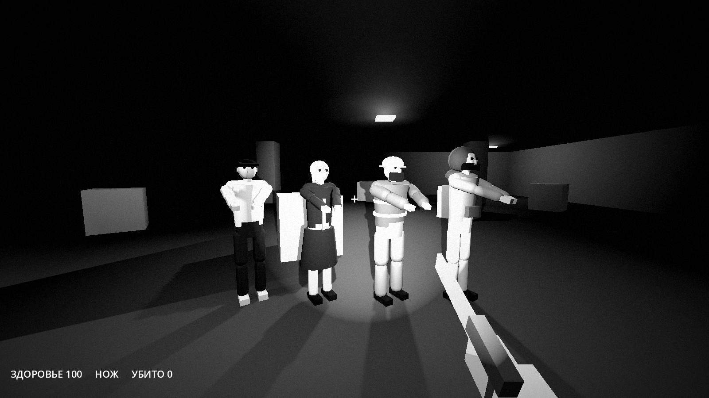

# Zombie Coop FPS

Кооперативный зомби-шутер от первого лица на разделённом экране. Чёрно-белый мир, красная только кровь. Игроки пробиваются к выходу из здания, а зомби разваливаются по-разному в зависимости от того, куда попала пуля.



План и дизайн: [документ с планом](https://claude.ai/artifact/KrgDqyad3fy6bYMVxXTXwv).

## Режимы

В меню выбирается режим и число игроков, от 1 до 4.

- **Выбраться из здания.** Этаж собирается случайно из комнат с дверями: проём бывает посередине стены, у левого или у правого края. Зомби бродят по комнатам и замечают игроков вблизи, на виду или на звук выстрела. Нужно найти выход («ВЫХОД», светящаяся площадка) и встать на него всем, кто на ногах. С каждым этажом комнат и зомби больше, снаряжение переносится на следующий этаж.
- **Волны.** Один зал, зомби лезут волнами, каждая больше предыдущей. Перед волной в зале появляются патроны, через волну — автомат или дробовик, раз в три волны — аптечка.



## Оружие и находки

| Оружие | Урон | Магазин | Запас максимум | Особенность |
| --- | --- | --- | --- | --- |
| Нож | 90 | — | — | есть всегда, бесшумный, вплотную |
| Пистолет | 34 | 12 | 192 | точный |
| Автомат | 22 | 30 | 480 | автоматический огонь |
| Дробовик | 16 × 10 дробин | 6 | 96 | рвёт вблизи |

Патроны конечные, их нужно искать. На первом этаже в стартовой комнате лежит по пистолету на каждого, дальше в комнатах попадаются патроны, оружие и редкие аптечки (не больше одной на 5 комнат, лечат 40 из 100). Предмет подбирается, если подойти к нему и он пригодится. Чем глубже этаж, тем чаще автомат и дробовик.

Патронами можно поделиться: подойти к напарнику и нажать G или B на геймпаде. Уходит половина запаса оружия в руках, а с ножом в руках — тех патронов, которых больше всего.

## Что ещё есть

- Четыре персонажа с разным силуэтом, чтобы различать их без цвета: 1 — светлая куртка, кепка и рюкзак; 2 — тёмное пальто и светлый хвост волос; 3 — каска, жилет с полосами и борода; 4 — капюшон и повязка на лице. Напарники видят у тебя в руках то же оружие, что и ты.
- Живых видно сразу: они прямые, в чистой одежде со слабым свечением и с горящим фонарём на плече.
- Зомби сгорбленные, с серой гниющей кожей в трупных пятнах, мутными светящимися бельмами, оскалом зубов и кровавой слюной. У кого-то выбит глаз, прогнила щека, торчит сломанная кость, из вспоротого живота свисают кишки. Руки тянутся вперёд, голова болтается.
- Походки: обычный шаркающий шаг, хромые (волочат негнущуюся ногу и заваливаются на неё, идут рывками) и быстрые (сильнее наклонены вперёд, примерно в полтора раза быстрее).
- 6 зон попадания: голова (×1,5 урона), торс, две руки, две ноги. Зомби живучие: голову пробивает третья пуля пистолета (из автомата — четвёртая), в корпус нужно 8 пуль пистолета или 12 из автомата, дробовик в упор убивает с двух выстрелов. Пуля, задевшая голову вскользь, или разбитая пулями голова сносит верх черепа: зомби жив, мозги вываливаются и стекают по лицу, голова держится, но вдвое слабее.
- Раны копятся и выглядят рваными: чёрная дыра, вокруг клочья мяса и крови, рядом на коже брызги по направлению пули, вниз потёк. Рана ложится точно на кожу и крепится к тому суставу, куда попала пуля (предплечье, голень), поэтому сгибается вместе с ним и не висит в воздухе. Капли крови летят вытянутыми каплями по направлению падения и тают, а не замирают. Пуля в корпус или голову часто выходит насквозь, и со спины рана больше, с вырванным мясом. Из ран летят куски мяса. Каждые три раны на одной части тела пропитывают кровью ещё кусок одежды. Изрешечённая грудь разворочена до рёбер, живот вспорот и кишки свисают, из рук и ног торчит перебитая кость, в лице дыра с зубами.
- Звуки попаданий разные: по голове стучит череп, по корпусу хлёсткий шлепок по мясу (иногда с мокрым чавканьем), по рукам и ногам то мясо, то кость, сверху шлёпают брызги крови. Все звуки глухие и низкие, без звонких верхов. У каждого звука шесть вариантов и случайная высота. Рвущееся мясо слышно, когда отрывается предплечье или конечность, пули в труп звучат глуше и мокрее.
- Бродячие зомби мычат, а при атаке рычат, как и раньше. От попаданий они вскрикивают настоящими голосами (записи с freesound, CC0): глухой стон боли, резкий вскрик, визг, когда отрывает руку или раскалывает череп, и предсмертный хрип. Рёв боли сквозь зубы, бульканье кровью и вой при падении на колени остались синтезом. У каждого зомби своя высота голоса.
- Пистолет (9 мм) и автомат (MP5) звучат записями с freesound (CC0), у них свои сухие щелчки, у автомата перезарядка Узи. Дробовик прежний.
- Руки отрываются кусками: когда у руки остаётся меньше 60% прочности, пули отрывают предплечье с кистью, из локтя торчит раздробленная кость. Следующие попадания отрывают плечо. Обрубки рваные, с костью и клочьями мяса.
- Отдача от попаданий: зомби отлетает назад по направлению выстрела, откидывается корпусом, дёргается в сторону и, пока его толкают, почти не идёт вперёд. Пистолет отбрасывает примерно на метр за выстрел, автомат очередью держит зомби на месте, дробовик в упор отшвыривает метра на три и сбивает с ног: зомби падает навзничь и поднимается через секунду с небольшим. Трупы и оторванные части разлетаются, если по ним стрелять.
- Конечности держатся крепко: ногу отрывают три пули пистолета. Рука из автомата теряет предплечье со второй пули, плечо с четвёртой. Дробовик бьёт десятью дробинами с широким разлётом: вблизи кромсает одного, на расстоянии задевает нескольких.
- Перезарядка видна: оружие наклоняется, пустой магазин выпадает, левая рука вставляет новый и прихлопывает его. У дробовика рука по одному досылает патроны, в конце передёргивается цевьё. Напарники видят, как фигура опускает оружие и тянется к нему рукой.
- Удар ногой отшвыривает ближайшего зомби метра на три-четыре и роняет навзничь. Летящий зомби своим телом сбивает тех, кто стоит за ним, и те летят дальше, теряя скорость, так что одним ударом можно уронить целую колонну. Перезарядка удара 0,7 секунды.
- Удар или пуля не по центру уводят зомби вбок: чем дальше от середины тела, тем сильнее. Зомби сталкиваются как бильярдные шары: сбитый летит по линии между центрами, ударивший отскакивает в другую сторону, так что от удара вскользь толпа разлетается веером. Руки — маятники на плечах: сильный удар дёргает каждую руку по-своему и закручивает тело, руки по инерции взлетают, мотаются вперёд и вбок и затухают, а когда зомби падает или лежит, валятся под своим весом. Пока зомби на ногах, мышцы держат руки в позе.
- Падение по физике: тело опрокидывается вокруг ступней, ноги тормозят о пол, а верх продолжает лететь, дальше заваливает гравитация. Зомби падает в ту сторону, куда его толкнули (назад, вбок, наискосок), ударяется о пол с глухим звуком, немного подскакивает, голова мотается, а потом встаёт.
- Тела как у живых: каждое попадание дёргает тело по-своему. Пуля в грудь откидывает корпус и запрокидывает голову, в живот сгибает пополам, в бок разворачивает, в голову резко отбрасывает голову, в ногу роняет вперёд на раненую ногу, в руку отшвыривает руку. Тело перелетает и пару раз качается обратно.
- Простреленная нога или изрешечённый корпус подгибают колени: зомби оседает на колени, покачивается, опускается на руки и ползёт к игроку на четвереньках, шагая рукой и противоположным коленом. На четвереньках он вдвое медленнее, чем раньше.
- Убитый не разлетается на куски, а падает целиком и остаётся лежать трупом: от выстрела в голову валится как подкошенный по направлению пули или сначала оседает на колени, убитый в корпус оседает на колени, качается и падает лицом вперёд, ползущий обмякает. Тело ударяется о пол, и из-под него растекается лужа крови. Труп дёргается от каждой пули, у него можно отстрелить голову или руку, а изрешечённый разваливается на куски. Живые зомби идут прямо через трупы. Трупов на уровне не больше 30, самые старые убираются.
- Из каждой раны толчками бьёт кровь. Оторванная часть улетает с кровавым следом, из обрубка хлещет. Без правой ноги зомби ползёт с опорой на левую, без левой — на правую, без обеих — подтягивается на руках; без рук бьёт слабее. Чем меньше конечностей, тем медленнее ползёт: на коленях быстрее всех, на одной ноге медленнее, на руках ещё медленнее, а без ног и с отстреленными руками волочится плашмя, прижавшись к полу, еле-еле.
- Следы крови разной формы: кляксы с лучами и брызгами, потёки, вытянутые по направлению выстрела (на стенах стекают вниз), россыпи капель и лужи под телами. Пятно не свисает с края стены, колонны или ступеньки: если под ним кончается поверхность, оно становится меньше или не появляется. Раненый зомби капает на пол, чем больше ран — тем чаще, а ползущий оставляет за собой размазанную полосу.




- Кровь на полу и стенах по направлению выстрела, короткая пауза (hit-stop) на убийстве.
- Нуар-фильтр: всё серое, кроме крови, плюс контраст, зерно и виньетка.
- Звуки синтезированы кодом: выстрелы, взмах ножа, попадания, хруст, мычание и сдавленный крик зомби, подбор предметов.
- Мягкий aim assist для геймпада, подъём упавшего напарника.

## Запуск

Готовые сборки для macOS, Windows, Linux и браузера лежат на странице [Releases](https://github.com/alimbux/zombie-coop-fps/releases). Как запустить их (в том числе неподписанную сборку на macOS) и как выпустить новую — в [docs/install.md](docs/install.md).

Из исходников: Нужен [Godot 4.3](https://godotengine.org/download) или новее. Откройте папку проекта в Godot и нажмите F5 (Cmd+B на macOS).

## Управление

Игрок 1 играет на клавиатуре и мыши, остальные на геймпадах. Если геймпадов хватает на всех, у игрока 1 тоже геймпад.

| Действие | Клавиатура и мышь | Геймпад |
| --- | --- | --- |
| Ходьба | WASD | Левый стик |
| Обзор | Мышь | Правый стик |
| Выстрел, удар ножом | Левая кнопка мыши | Правый курок |
| Сменить оружие | 1–4, Q, колесо мыши | Y |
| Перезарядка | R | X |
| Удар ногой | F или правая кнопка мыши | RB |
| Отдать патроны напарнику | G | B |
| Поднять напарника | Подойти к упавшему и постоять 3 секунды | То же |
| В меню | Esc | Back |

Клик по окну захватывает мышь.

## Структура

```
scenes/menu.tscn          точка входа: меню
scripts/menu.gd           выбор режима и числа игроков
scripts/game_config.gd    выбранный режим, номер этажа, снаряжение между этажами
scenes/main.tscn          игра
scripts/main.gd           экран на 1–4 части, общий 3D-мир, выход с этажа, перезапуск
scripts/level_generator.gd процедурный этаж: комнаты, двери, выход, зомби, находки
scripts/weapons.gd        характеристики оружия
scripts/pickup.gd         оружие, патроны и аптечки на уровне
scripts/player.gd         игрок: движение, оружие, патроны, падение и подъём
scripts/zombie.gd         зомби: внешность, походка, зоны попадания, отрыв частей, ползание
scripts/player_model.gd   фигуры четырёх персонажей
scripts/mesh_kit.gd       общие меши и материалы для фигур
scripts/gore.gd           кровь, раны, мозги, пятна, отлетающие части, hit-stop
scripts/blood_stains.gd   формы кровавых пятен (рисуются процедурно в текстуры)
scripts/sfx.gd            звуки: удары, мычание и рык синтезированы кодом, оружие и вскрики зомби из записей
sounds/weapons/           записи выстрелов, перезарядок и щелчков (CC0, см. LICENSE.md там же)
sounds/zombies/           записи вскриков зомби (CC0, см. LICENSE.md там же)
tools/make_weapon_sounds.py  нарезка дробовика и перезарядки пистолета из Free Firearm Sound Library
tools/make_freesound_sounds.py  нарезка записей с freesound: пистолет, автомат, вскрики зомби
scripts/zombie_spawner.gd режим «Волны»
scripts/test_room.gd      зал для режима «Волны»
scripts/player_hud.gd     интерфейс половины экрана
shaders/noir.gdshader     ч/б фильтр с красной кровью
tests/smoke_test.gd       проверка без окна
tests/screenshot.gd       снимок экрана для документации
```

## Проверка

```
godot --headless --path . -s tests/smoke_test.gd
```

Проверяет меню и оба режима на 1–4 игроков, зоны попадания, нож и оружие, расход и подбор патронов, перезарядку, передачу патронов, аптечку, а генератор этажей — на связность, выход, отсутствие зомби в стартовой комнате и редкость аптечек.
