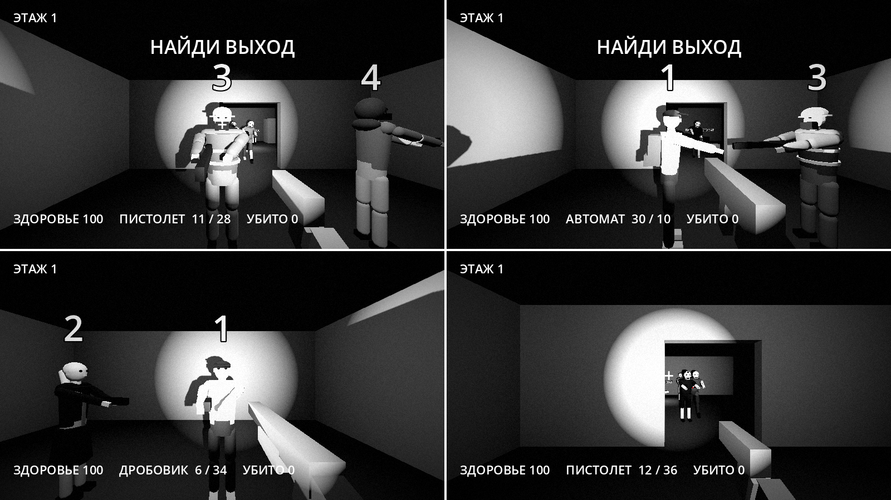
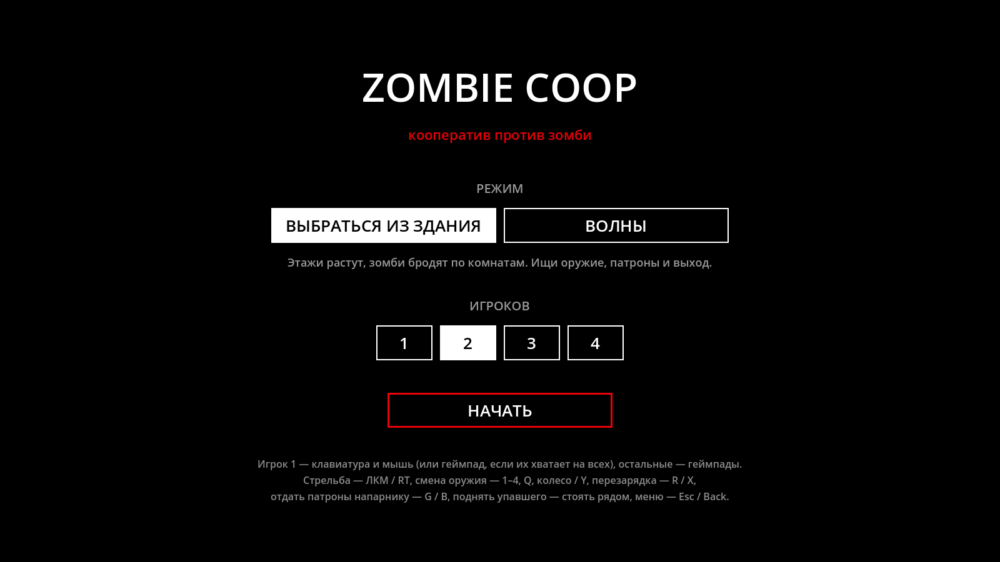
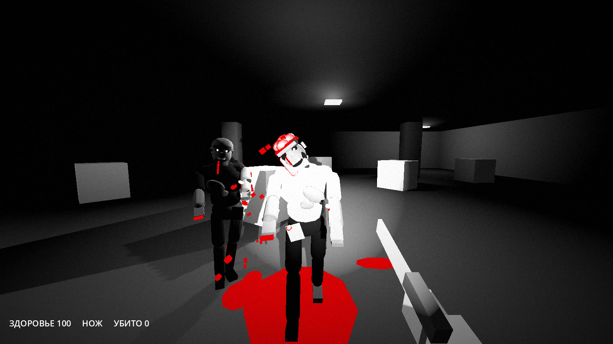
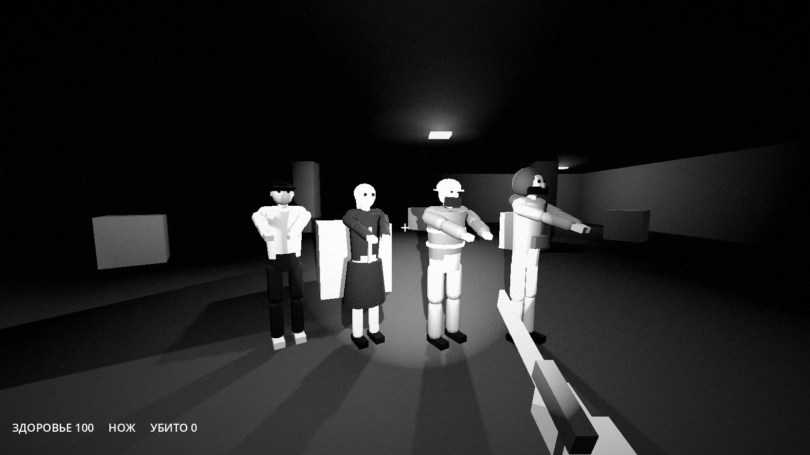

# Zombie Coop FPS

Кооперативный зомби-шутер от первого лица на разделённом экране. Чёрно-белый мир, красная только кровь. Игроки пробиваются к выходу из здания, а зомби разваливаются по-разному в зависимости от того, куда попала пуля.



План и дизайн: [документ с планом](https://claude.ai/artifact/KrgDqyad3fy6bYMVxXTXwv).

## Режимы

В меню выбирается режим и число игроков, от 1 до 4.

- **Выбраться из здания.** Этаж собирается случайно из комнат с дверями, зомби бродят по комнатам и замечают игроков вблизи, на виду или на звук выстрела. Нужно найти выход («ВЫХОД», светящаяся площадка) и встать на него всем, кто на ногах. С каждым этажом комнат и зомби больше, снаряжение переносится на следующий этаж.
- **Волны.** Один зал, зомби лезут волнами, каждая больше предыдущей. Перед волной в зале появляются патроны, через волну — автомат или дробовик, раз в три волны — аптечка.



## Оружие и находки

| Оружие | Урон | Магазин | Запас максимум | Особенность |
| --- | --- | --- | --- | --- |
| Нож | 45 | — | — | есть всегда, бесшумный, вплотную |
| Пистолет | 34 | 12 | 96 | точный |
| Автомат | 22 | 30 | 240 | автоматический огонь |
| Дробовик | 16 × 8 дробин | 6 | 48 | рвёт вблизи |

Патроны конечные, их нужно искать. На первом этаже в стартовой комнате лежит по пистолету на каждого, дальше в комнатах попадаются патроны, оружие и редкие аптечки (не больше одной на 5 комнат, лечат 40 из 100). Предмет подбирается, если подойти к нему и он пригодится. Чем глубже этаж, тем чаще автомат и дробовик.

Патронами можно поделиться: подойти к напарнику и нажать G или B на геймпаде. Уходит половина запаса оружия в руках, а с ножом в руках — тех патронов, которых больше всего.

## Что ещё есть

- Четыре персонажа с разным силуэтом, чтобы различать их без цвета: 1 — светлая куртка, кепка и рюкзак; 2 — тёмное пальто и светлый хвост волос; 3 — каска, жилет с полосами и борода; 4 — капюшон и повязка на лице. Напарники видят у тебя в руках то же оружие, что и ты.
- Живых видно сразу: они прямые, в чистой одежде со слабым свечением и с горящим фонарём на плече.
- Зомби сгорбленные, с серой гниющей кожей в трупных пятнах, мутными светящимися бельмами, оскалом зубов и кровавой слюной. У кого-то выбит глаз, прогнила щека, торчит сломанная кость, из вспоротого живота свисают кишки. Руки тянутся вперёд, голова болтается.
- Походки: обычный шаркающий шаг, хромые (волочат негнущуюся ногу и заваливаются на неё, идут рывками) и быстрые (сильнее наклонены вперёд, примерно в полтора раза быстрее).
- 6 зон попадания: голова (×3 урона, мгновенная смерть), торс, две руки, две ноги. Пуля, задевшая голову вскользь, сносит верх черепа: зомби жив, мозги вываливаются и стекают по лицу, следующее попадание в голову добивает.
- Отдача от попаданий: зомби отлетает назад по направлению выстрела, откидывается корпусом, дёргается в сторону и, пока его толкают, почти не идёт вперёд. Пистолет отбрасывает примерно на метр за выстрел, автомат очередью держит зомби на месте, дробовик в упор отшвыривает метра на три и сбивает с ног: зомби падает навзничь и поднимается через секунду с небольшим. Трупы и оторванные части разлетаются, если по ним стрелять.
- Из каждой раны толчками бьёт кровь. Оторванная часть улетает с кровавым следом, из обрубка хлещет. Без правой ноги зомби ползёт с опорой на левую, без левой — на правую, без обеих — подтягивается на руках; без рук бьёт слабее.




- Кровь на полу и стенах по направлению выстрела, короткая пауза (hit-stop) на убийстве.
- Нуар-фильтр: всё серое, кроме крови, плюс контраст, зерно и виньетка.
- Звуки синтезированы кодом: выстрелы, взмах ножа, попадания, хруст, мычание и сдавленный крик зомби, подбор предметов.
- Мягкий aim assist для геймпада, подъём упавшего напарника.

## Запуск

Готовые сборки для macOS, Windows, Linux и браузера лежат в папке [release/](release/), там же инструкция, как открыть неподписанную сборку на macOS.

Из исходников: Нужен [Godot 4.3](https://godotengine.org/download) или новее. Откройте папку проекта в Godot и нажмите F5 (Cmd+B на macOS).

## Управление

Игрок 1 играет на клавиатуре и мыши, остальные на геймпадах. Если геймпадов хватает на всех, у игрока 1 тоже геймпад.

| Действие | Клавиатура и мышь | Геймпад |
| --- | --- | --- |
| Ходьба | WASD | Левый стик |
| Обзор | Мышь | Правый стик |
| Выстрел, удар ножом | Левая кнопка мыши | Правый курок |
| Сменить оружие | 1–4, Q, колесо мыши | Y |
| Перезарядка | R | X |
| Отдать патроны напарнику | G | B |
| Поднять напарника | Подойти к упавшему и постоять 3 секунды | То же |
| В меню | Esc | Back |

Клик по окну захватывает мышь.

## Структура

```
scenes/menu.tscn          точка входа: меню
scripts/menu.gd           выбор режима и числа игроков
scripts/game_config.gd    выбранный режим, номер этажа, снаряжение между этажами
scenes/main.tscn          игра
scripts/main.gd           экран на 1–4 части, общий 3D-мир, выход с этажа, перезапуск
scripts/level_generator.gd процедурный этаж: комнаты, двери, выход, зомби, находки
scripts/weapons.gd        характеристики оружия
scripts/pickup.gd         оружие, патроны и аптечки на уровне
scripts/player.gd         игрок: движение, оружие, патроны, падение и подъём
scripts/zombie.gd         зомби: внешность, походка, зоны попадания, отрыв частей, ползание
scripts/player_model.gd   фигуры четырёх персонажей
scripts/mesh_kit.gd       общие меши и материалы для фигур
scripts/gore.gd           кровь, раны, мозги, пятна, отлетающие части, hit-stop
scripts/sfx.gd            звуки, синтезированные кодом
scripts/zombie_spawner.gd режим «Волны»
scripts/test_room.gd      зал для режима «Волны»
scripts/player_hud.gd     интерфейс половины экрана
shaders/noir.gdshader     ч/б фильтр с красной кровью
tests/smoke_test.gd       проверка без окна
tests/screenshot.gd       снимок экрана для документации
```

## Проверка

```
godot --headless --path . -s tests/smoke_test.gd
```

Проверяет меню и оба режима на 1–4 игроков, зоны попадания, нож и оружие, расход и подбор патронов, перезарядку, передачу патронов, аптечку, а генератор этажей — на связность, выход, отсутствие зомби в стартовой комнате и редкость аптечек.
